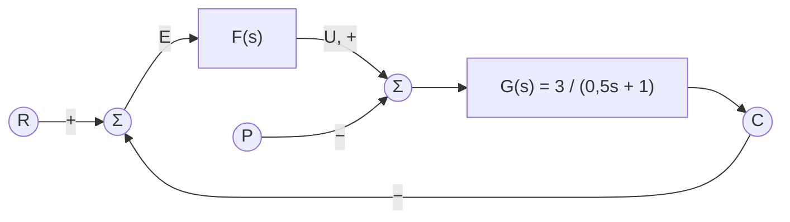

**Enunciado (resumen).** Planta `G(s) = 3/(0,5s + 1)` [m/V], realimentación unitaria. `R(s)` es la referencia, `P(s)` una fuga constante que **resta a la entrada de la planta** y `C(s)` el nivel.

Se pide:

- **a)** Error en régimen permanente con `F(s) = 2`, `R = 2` V (escalón) y una fuga que equivale a `P = 0,5` V a la entrada de la planta.
- **b)** Se digitaliza con ZOH a `T = 50` ms, con `B₀G(z) = 0,2856/(z − 0,9048)`. Calcula `k_s` (muestras) para que el lazo cerrado tenga el mismo tiempo de establecimiento que la planta continua en lazo abierto.
- **c)** Halla la ganancia `K` de `F(z) = K` que cumple (b) con un polo de lazo cerrado que produzca **oscilaciones ocultas**.

## Qué te están preguntando

(a) es **superposición**: dos entradas, un error. La fuga no entra donde entra `R`, y eso cambia su peso. (b) y (c) trasladan una especificación de tiempo de s a z: mismo `t_s`, mismo `k_s`, y de ahí sale el módulo del polo.

Solución paso a paso

**a) Error en RP con referencia y fuga.**

Ganancia estática de la cadena abierta: `K₀ = F(0)·G(0) = 2·3 = 6`. Sin integradores (tipo 0), el error es finito.

La fuga entra **después** del regulador y **antes** de la planta, restando. En régimen permanente (`s → 0`, todo constante):

c = G(0)·[ F(0)·(R − c) − P ]   ⇒   c = (K₀·R − G(0)·P) / (1 + K₀)

c(∞) = (6·2 − 3·0,5)/7 = 10,5/7 = 1,5 V   ⇒   e = R − c = <b>0,5 V</b>

Por superposición, `e = e_R + e_P`:

| Efecto | Fórmula | Valor |
|---|---|---|
| Referencia | `R/(1 + K₀)` | `2/7 = 0,286 V` |
| Fuga | `G(0)·P/(1 + K₀)` | `1,5/7 = 0,214 V` |
| **Total** | | **0,5 V** |

**Cuidado.** La fuga llega a la salida **a través de la planta**, por eso aparece `G(0) = 3`. Si se usa `P/(1 + K₀)` sin `G(0)` sale 0,357 V, que es incorrecto: es como si la fuga entrara a la salida.

**b) Especificación de `k_s`.**

El polo continuo está en `s = −1/τ = −2`. Con el criterio del curso, `t_s = π/|σ|`:

t_s = π/2 = 1,571 s   ⇒   k_s = ⌈t_s/T⌉ = ⌈1,571/0,05⌉ = ⌈31,4⌉ = <b>32</b> muestras

Comprobación: el polo discreto de la planta es `e^(−2·0,05) = e^(−0,1) = 0,9048`, y `⌈−π/ln 0,9048⌉ = ⌈π/0,1⌉ = 32`. La planta en lazo abierto ya cumple `k_s = 32`: hay que **mantenerlo** al cerrar el lazo.

**c) Ganancia K.**

Módulo del polo deseado: `|p| = e^(−π/32) = 0,9065`.

Ecuación característica: `1 + K·0,2856/(z − 0,9048) = 0` ⇒ `z = 0,9048 − 0,2856·K`.

Oscilaciones ocultas = polo real **negativo** (`∠p = π`, periodo de 2 muestras). Se iguala a `−|p|`:

0,9048 − 0,2856·K = −0,9065   ⇒   K = 1,8113/0,2856 = <b>6,34</b>

(La otra raíz, `+0,9065`, da `K ≈ 0`: es el lazo abierto, sin control.)

**Dos comprobaciones que conviene hacer:**

- **Estabilidad.** El polo cruza `z = −1` en `K = 1,9048/0,2856 = 6,67`. Con `K = 6,34` se está al 95 % del límite: es un diseño frágil.
- **Error en régimen permanente.** `K_p = K·B₀G(1) = 3K ≈ 19`, así que el error al escalón es `1/(1 + 3K) ≈ 5 %`.

**Nota sobre la convención.** Con `L(0,05) ≈ −3` en vez de `π` (como en el ejercicio 5): `t_s = 3τ = 1,5 s`, `k_s = 30`, `|p| = e^(−0,1) = 0,9048` y `K = 6,34`. El resultado práctico es el mismo; sigue la convención que pida el enunciado.

| e (RP) | k_s (b) | \|p\| | K |
|---|---|---|---|
| 0,5 V | 32 | 0,9065 | 6,34 |

## Herramienta

Arriba, el apartado a): cambia `F` y mira cómo el error se reparte entre referencia y fuga (la fuga aparece a mitad del ensayo). Abajo, los apartados b) y c): mueve `K` y observa el polo, `k_s` y el límite de estabilidad.

**Qué comprobar**
- Con `F = 2`: antes de la fuga `e = 0,286 V`; después, **0,5 V**. Sube `F` y el error baja, pero nunca llega a 0 (tipo 0).
- Con `K = 6,34`: respuesta en zig-zag (polo negativo), `k_s = 32` y error final ≈ 5 %.
- Sube `K` hacia 6,67: el zig-zag deja de apagarse. Pasado ese valor es inestable.
