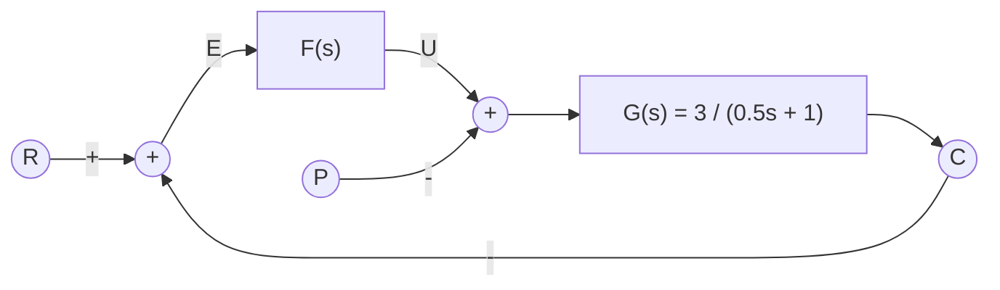

**Enunciado.** Se desea controlar el nivel de líquido de un tanque industrial. El sistema en lazo abierto (válvula, tanque y sensor) se ha modelado mediante una planta con función de transferencia $G(s) = \frac{3}{0.5s + 1}$ [m/V]. El sistema se realimenta de forma unitaria.

A continuación se muestra el diagrama de bloques del sistema continuo, donde $R(s)$ es la referencia de nivel, $P(s)$ es una perturbación equivalente a una fuga constante en el tanque, y $C(s)$ es el nivel real.

Se pide:
(a) Calcular el error en régimen permanente (RP) si se utiliza un regulador proporcional $F(s) = 2$, una referencia escalón de $2$ V y se produce una perturbación (fuga) constante cuyo efecto a la entrada de la planta equivale a $0.5$ V.
(b) Se decide digitalizar el control con un bloqueador de orden cero (ZOH) a un periodo $T = 50$ ms. Sabiendo que el equivalente discreto de la planta es $B_0G(z) = \frac{0.2856}{z - 0.9048}$, calcula el parámetro $k_s$ (en muestras) si se desea que el sistema realimentado tenga exactamente el mismo tiempo de establecimiento que la planta continua en lazo abierto.
(c) Hallar la ganancia $K$ del regulador discreto $F(z) = K$ necesaria para cumplir el objetivo del apartado (b) forzando un polo dominante de lazo cerrado que provoque una respuesta con oscilaciones ocultas.

## Qué te están preguntando

Este problema evalúa tu capacidad para aplicar el **principio de superposición** frente a perturbaciones en estado estacionario y tu habilidad para trasladar especificaciones temporales (como el tiempo de establecimiento, $t_s$) del dominio de Laplace al dominio discreto $Z$.

Solución paso a paso

**a) Error en RP con perturbación (Superposición).**
La ganancia estática de la cadena abierta es $K_0[CA] = F(0) \cdot G(0) = 2 \cdot 3 = 6$.
Al ser un sistema de Tipo 0 (sin integradores), el error será constante. El error total es la suma de los efectos de la referencia ($R$) y la perturbación ($P$).
- Efecto de la referencia ($R = 2$):
  $$e_{rp-R} = \frac{R}{1 + K_0[CA]} = \frac{2}{1 + 6} = \frac{2}{7} \approx 0.286 \text{ V}$$
- Efecto de la perturbación ($P = 0.5$). La perturbación entra restando *después* del controlador, por lo que su contribución al error de realimentación (entrada menos salida) se calcula como:
  $$e_{rp-P} = \frac{P \cdot G(0)}{1 + K_0[CA]} \cdot \frac{1}{G(0)} = \frac{P}{1 + K_0[CA]} = \frac{0.5}{7} \approx 0.071 \text{ V}$$
- Error total: 
  $$e_{rp} = e_{rp-R} + e_{rp-P} = \frac{2.5}{7} \approx 0.357 \text{ V}$$

**b) Especificación del tiempo de establecimiento discreto.**
El tiempo de establecimiento de la planta continua pura ($G(s) = \frac{3}{0.5s + 1}$) depende de su constante de tiempo $\tau = 0.5$ s. Asumiendo el criterio general del 5%:
$$t_s = \pi \tau = \pi \cdot 0.5 \approx 1.57 \text{ s}$$
Para trasladar esto a muestras ($k_s$) con un periodo $T = 0.05$ s:
$$k_s = \lceil \frac{t_s}{T} \rceil = \lceil \frac{1.57}{0.05} \rceil = \lceil 31.4 \rceil = 32 \text{ muestras}$$

**c) Cálculo de la ganancia K.**
Buscamos un polo de lazo cerrado cuyo módulo cumpla con el $k_s$ deseado: $|p| = e^{-\pi / k_s}$.
$$|p| = e^{-\pi / 32} \approx 0.9065$$
La ecuación característica del lazo cerrado es $1 + K \cdot B_0G(z) = 0$:
$$1 + K \frac{0.2856}{z - 0.9048} = 0 \implies z - 0.9048 + 0.2856K = 0$$
El polo de lazo cerrado está en $z = 0.9048 - 0.2856K$.
Como nos piden una respuesta con "oscilaciones ocultas" (frecuencia de oscilación máxima en discreto), el polo debe estar en el semieje real negativo. Igualamos a $-|p|$:
$$0.9048 - 0.2856K = -0.9065 \implies 0.2856K = 1.8113 \implies K \approx 6.34$$

## Herramienta

Utiliza el deslizador interactivo para modificar la ganancia $K$. Observa en la gráfica cómo una ganancia alta reduce el impacto de la fuga (perturbación), pero a costa de introducir oscilaciones de alta frecuencia si el polo cruza al semiplano izquierdo del plano Z.

**Qué comprobar**
- Con $K=2$, verifica el error estacionario de $\approx 0.357$ tras la entrada de la perturbación.
- Aumenta $K$ a $6.34$. Verás un transitorio fuertemente oscilatorio (en "zig-zag") que se asienta exactamente a las 32 muestras, tal como predecía la teoría.